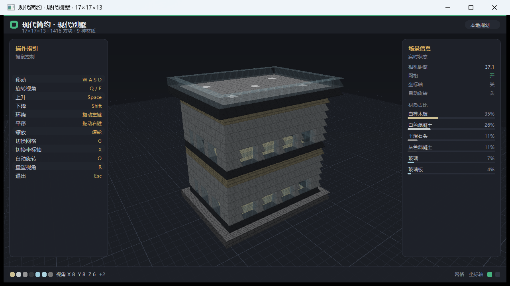
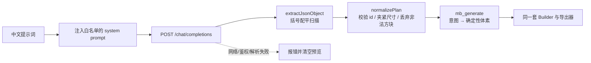

<div align="center">

# ⛏ Minecraft Builder

**用一句话描述，生成真正可建造的 Minecraft 建筑**

大模型规划建筑意图 → 确定性体素建模 → 桌面 3D 工作台 / 逐层平面图 / 一键导出 `.mcfunction`

一个 **C11 桌面应用**。默认启动 Raylib + Raygui 图形界面；核心几何、JSON 与 HTTP 实现仍是 C，第三方 UI 依赖随仓库提供。

[](./LICENSE)


</div>

---

## 这是什么

一个带桌面工作台的 Minecraft 建筑生成器。

你输入一句中文描述，比如：

> 帮我建一座现代风格的两层别墅，白墙大落地窗，尺寸 15x11

默认打开 **Raylib + Raygui 桌面界面**：左侧输入建筑描述与控制生成，中间查看可旋转缩放的 3D 建筑或逐层平面图，侧栏浏览材料统计；报告、导出和模型设置也都在窗口内完成。另可用 `--tui` 启动终端界面，或用 `--shot` 无窗口渲染 BMP。

**项目现在是 AI-only**：生成路径只有一条——先把提示词交给模型，再把模型返回的建筑意图交给确定性构建器。因此需要先在「模型设置」里配好 OpenAI 兼容接口、模型名和 API Key（Ollama 预设可留空 Key）；没有不依赖模型的离线生成模式。桌面端启动时 3D 视口是空的，**打开窗口本身不会调用 API**，点「生成建筑」才会发请求。

**它不是一个"画得像"的演示，而是一个能真的盖出来的工具。** 导出的每一个方块坐标都在建筑包围盒内、没有重复、没有空洞，`.mcfunction` 的行数与方块数严格相等——这些都由自动化测试守着（见[开发与测试](#开发与测试)）。

> ### 🧠 关于"AI"的说明
>
> 这个项目的"AI"是真的接大模型，每个新方案都从一次真实的模型调用开始；但它把大模型放在了一个**很窄、很安全**的位置上：
>
> ```
> 你说的话 ──▶ 大模型 ──▶ 建筑意图（JSON）──▶ 确定性体素构建器 ──▶ 方块坐标
>                          类型/风格/尺寸/材质/命名        几何只由代码算
> ```
>
> 大模型负责它擅长的：听懂含糊的中文、判断该盖什么、定尺寸、挑配色、起个名字。
> 大模型**不**输出任何方块坐标——几何全部由参数化构建器算出来。
> 所以模型就算开始胡言乱语，最坏的结果也只是"选错了模板"，永远不可能给你一座盖不出来的建筑。
>
> **支持任意 OpenAI 兼容接口**：DeepSeek / OpenAI / Kimi / 智谱 GLM / 通义千问 / Ollama 本地模型，都在内置预设里，也可以填任意自建中转地址。
>
> **没有离线兜底**：生成必须配置 OpenAI 兼容的 endpoint、模型名和 API Key（Ollama 预设可留空）。配置不可用时点「生成建筑」会直接给出错误提示，而不是退回某个本地规则引擎。

---

## 功能特性

| | |
|---|---|
| 🖥️ **桌面工作台** | Raylib 6.2 + Raygui 即时模式 UI；提示词、3D 视口、平面图、材料、报告、导出与模型设置集中在一个窗口 |
| 🧩 **随仓库提供依赖** | Raylib 静态库与 Raygui 单头文件已放入 `c/vendor/`，无需额外安装 UI SDK |
| ⌨️ **可选终端 TUI** | `mb.exe --tui` 启动 ANSI truecolor 终端界面 |
| 🤖 **大模型规划** | 每个新方案都通过一次 OpenAI 兼容接口调用产出，模型返回结构化建筑意图，支持一键测试连接 |
| 🔑 **必须配置模型** | 需要 endpoint + 模型名 + API Key（Ollama 可留空）；没有配置就生成失败，没有不依赖模型的离线模式 |
| 🗣️ **中文提示词理解** | 模型直接读懂一句话里的建筑类型、材质风格、体量、层数、显式尺寸和具体方块名，再落成结构化意图 |
| 🏗️ **6 套参数化模板** | 现代别墅 / 原木小屋 / 城堡塔楼 / 树屋 / 石桥 / 城墙，每套都是真正"能住/能走"的结构 |
| 🎨 **7 套材质风格** | 现代简约 / 中世纪石造 / 乡村木质 / 沙漠砂岩 / 奇幻魔法 / 工业冷调 / 废墟苔痕 |
| 🛡️ **幻觉兜底** | 模型返回的每个 id 都会被校验（非法方块名丢弃、尺寸越界夹紧、未知模板回退），保证结果始终可建造 |
| 📐 **逐层平面图** | `[` `]` 翻层，下层以暗色"幽灵"叠加，一眼看清每层的墙线与开洞位置 |
| 🧱 **材料清单** | 每种方块的用量与占比，按用量排序——照着这个备料就行 |
| 🔍 **生成报告** | 把"这次是谁决定的、决定了什么"完全摊开：模型给出的模板、风格、尺寸、配色、命名、关键词、修饰语与备注，加上模型名与规划耗时 |
| 🌱 **种子可复现** | 同一份模型意图 + 同一种子 = 完全相同的结果；「换个方案」复用缓存意图换种子，不重复扣 token |
| 📦 **4 种导出** | `.mcfunction` / `.json` / 材料 `.csv` / 中文说明 `.md` |

---

## 构建

需要 **Windows x64 + MinGW-w64 GCC**（推荐 [winlibs](https://winlibs.com/) 构建，自带 `mingw32-make`）。Raylib 6.2 静态库和 Raygui 头文件已随仓库提供。

```powershell
cd c
mingw32-make             # 编译 build/mb.exe
mingw32-make run         # 编译并启动桌面图形界面
build\mb.exe --tui       # 可选：启动终端界面
mingw32-make test        # 编译并跑核心测试
mingw32-make clean       # 清掉 build/
```

> **注意**：winlibs 工具链里**没有** `make`，只有 `mingw32-make`。直接敲 `make` 会找不到命令。
>
> 编译本身不需要联网或 Key。首次运行前先打开「模型设置」（GUI 页签或 TUI 的 `5`）填好 endpoint、模型名和 API Key；否则可以打开界面，但一点「生成建筑」就会报配置错误。

### 如果工具链装在带空格的路径里

`C:\Program Files (x86)\...` 这种路径会让 MinGW 连**空程序都链不出来**：GCC 的 `*endfile` spec 会把 `default-manifest.o` 以**未加引号**的绝对路径塞进链接命令，ld 在空格处断词，然后报 `cannot find C:/Program`。

本仓库的解法是用 `-specs` 覆盖掉那一个对象（控制台程序本来也不需要嵌入 application manifest）——见 [`c/tools/no-manifest.specs`](c/tools/no-manifest.specs)，`Makefile` 会在 Windows 上自动加上它。

**更省事的替代方案**：把工具链卸了重装到无空格路径（比如 `C:\mingw64`），这个 workaround 就完全用不上了。

---

## 桌面界面

- 左侧边栏：提示词输入框、「生成建筑」按钮（调用模型）、「换个方案」按钮（复用已缓存的模型意图换种子，不额外消耗 token），以及一个直达「模型设置」页签的快捷按钮。
- 启动时 3D 视口是空的，打开界面本身不产生任何 API 调用；点「生成建筑」才会真正请求模型。
- 没有可用配置（endpoint / 模型 / Key）时，点「生成建筑」会直接报错并说明缺哪一项，而不是退回本地规则。
- 拖动 3D 视口旋转，滚轮缩放；网格、坐标轴和自动环绕可单独切换。
- 顶部页签切换 3D 预览、楼层图、生成报告、导出文件和模型设置。
- 模型设置支持服务预设、Base URL、API Key、模型名、温度、JSON 模式与连接测试；Base URL 和 API Key 可用 `Ctrl+V` 直接粘贴。
- 设置点「保存设置」立即写入；退出窗口时也会自动保存 endpoint、Key、模型、温度与 JSON 模式，下次启动继续生效。
- 配置文件优先放在 `%APPDATA%\MinecraftBuilder\settings.ini`；如果该位置不可写（受限账户或安全软件会拒绝未签名程序写用户目录），会自动回退到程序目录下的 `settings.ini`。
- 中文界面字体优先使用系统 DengXian，缺失时依次回退到 Microsoft YaHei / SimHei / SimSun；界面上新出现的文字（包括模型返回的名字与备注）会自动补齐字形。

## 可选终端 TUI 操作

终端模式通过 `build/mb.exe --tui` 显式启动。它是**模态**的：默认所有字母都是命令，按 `i` 才把键盘交给提示词输入框。

| 键 | 作用 |
|---|---|
| `i` | 编辑提示词（输入模式下 Enter 确认、Esc 取消） |
| `Enter` | 用当前提示词生成建筑（调用模型） |
| `t` | 测试大模型连接（调 `/models` 核对模型名在不在） |
| `g` | 换一个变体（对**已缓存的方案**重新抖种子，不重复扣 token） |
| `Tab` / `1`-`5` | 切换标签页：3D 预览 / 平面图 / 报告 / 导出 / 设置 |
| `←` `→` `↑` `↓` | 旋转视角（3D 预览页） |
| `[` `]` | 切换查看的楼层（平面图页） |
| `-` `+` | 缩放 |
| `q` | 退出 |

### 标签页

- **3D 预览**：ANSI truecolor 逐像素等距投影渲染，玻璃半透明、光源方块自发光、带后沿明暗。
- **平面图**：逐层俯视图，`[` `]` 翻层，下层以暗色"幽灵"叠加。
- **报告**：把"这次是谁决定的、决定了什么"摊开——模型给出的模板、风格、尺寸、配色、命名、关键词、修饰语与备注，以及模型名 / endpoint / 规划耗时。
- **导出**：`.mcfunction` / `.json` / `.csv` / `.md` 四种，Enter 写入当前目录。
- **设置**：服务预设 / Base URL / API Key / 模型名 / 温度 / JSON 模式。

---

## 独立 3D 预览窗口

默认桌面工作台已内置 Raylib 3D 视口。也可以用 `mb --preview` 单独打开 Win32 预览窗口，围绕建筑查看材质和接缝——它和 GUI 走同一条生成路径，同样需要先配好模型：



这个独立预览器使用手写软件光栅器；近平面裁剪、z-buffer、透视插值、背面剔除和体素相邻面剔除都在 [`c/src/gfx3d.c`](c/src/gfx3d.c) 中实现，不依赖图形 API，因此命令行截图与核心测试也能直接调用。桌面主界面的窗口和控件由 Raylib + Raygui 提供。

### 操作

| 键 / 鼠标 | 作用 |
|---|---|
| `W` `A` `S` `D` | 平移视点（贴着地面走） |
| `Q` `E` | 旋转视角 |
| `Space` / `Shift` | 上升 / 下降 |
| 拖动左键 | 环绕 |
| 拖动右键 | 平移 |
| 滚轮 | 缩放 |
| `G` | 切换地面网格 |
| `X` | 切换坐标轴 |
| `O` | 自动环绕 |
| `R` | 重置视角 |
| `Esc` | 关闭 |

### 命令行

不开窗口也能出图，输出 24 位 BMP——渲染这条路径是平台无关的；但 `--shot` 会先调用模型，所以同样需要可用的 endpoint 与 Key（它不是离线截图）：

```bash
mb --shot build/house.bmp --size 1100x700 --prompt "现代风格两层别墅，白墙大落地窗，尺寸 15x11"
mb --shot build/close.bmp --size 900x600 --yaw 30 --pitch -18 --dist 11 --prompt "..."   # 指定机位
```

| 参数 | 说明 |
|---|---|
| `--shot <file>` | 渲染到 BMP 文件后退出 |
| `--size WxH` | 输出分辨率，最小 64×64 |
| `--yaw <度>` | 覆盖相机水平角（仅 `--shot` 有效） |
| `--pitch <度>` | 覆盖相机俯仰角 |
| `--dist <方块>` | 覆盖相机到建筑中心的距离 |

### 三个值得说的取舍

**方块贴图是代码生成的。** Minecraft 的官方材质有版权，本仓库**不附带任何游戏素材**。每张 16×16 贴图都是运行时按材质 id 生成的乘性噪声图（三倍频 fbm，值域 0.5–1.5），石砌有颗粒、木板有木纹、树叶有团块，方块边缘再压一圈暗描边——远看是纹理，近看是接缝。

**地面用距离雾收尾，而不是无限延伸。** 地面其实是个有限的网格平面，但它会随距离逐渐混入地平线色，所以看不出来是在哪里断掉的。雾的起点是从相机到**建筑中心**的距离，不是到原点——不管相机怎么摆，雾都不会爬到模型身上。

**玻璃那一趟也写深度。** 半透明必须从后往前画，但如果这趟不写 z-buffer，一条视线上的每块玻璃都会再混一次同一个色调——一面玻璃幕墙最后会黑成一块板子。让最近的那块玻璃先占住像素，幕墙就只剩一层淡蓝。

---

## 接入大模型

生成前必须在「模型设置」页填好这几项（TUI 里是 `5` 设置页）：

| 字段 | 说明 |
|---|---|
| 服务预设 | 内置 DeepSeek / OpenAI / Kimi / 智谱 GLM / 通义千问 / Ollama 本地 六个预设，选中会自动填好下面两项 |
| Base URL | 任何 OpenAI 兼容地址，比如 `https://api.deepseek.com/v1`，自建中转也能填 |
| 模型名 | 比如 `deepseek-chat` |
| API Key | 随请求直接发给模型服务，仅保存在本机配置文件里 |

填完点「测试连接」可以先确认通不通（会调 `/models` 列出可用模型并核对你要用的那个在不在）。之后回到界面点「生成建筑」或按 TUI 的 `Enter` 就会真正调用模型——现在没有“关闭 AI、走本地”这个开关，也没有对应的 `a` 键。

这些设置优先保存在 `%APPDATA%\MinecraftBuilder\settings.ini`（Linux/macOS 为 `~/.config/minecraft-builder/settings.ini`）。如果用户目录不可写（受限账户、安全软件拦截未签名程序写用户目录时常见），会自动回退到程序所在目录的 `settings.ini`；GUI 和 TUI 共用同一份文件：窗口关闭、终端退出或点「保存设置」时自动写入 endpoint、Key、模型、温度与 JSON 模式，下次启动自动读回。

Ollama 预设的 API Key 可以留空；本地跑之前需要放开跨域：

```bash
OLLAMA_ORIGINS='*' ollama serve
```

### 模型到底被允许做什么

发给模型的系统提示里会**注入真实的 id 白名单**——6 个模板 id、7 个风格 id、约 40 个方块 id，全是代码里的目录。模型只能从这些里面挑，然后返回一份这样的 JSON：

```json
{
  "structure": "castle-tower",
  "style": "medieval",
  "scale": "large",
  "width": 14, "depth": 14, "height": 30, "floors": 3,
  "palette": { "wall": "stone_bricks", "roof": "deepslate_bricks" },
  "name": "灰石哨塔",
  "keywords": ["城堡", "塔楼"],
  "modifiers": ["多层结构"],
  "notes": ["三层石塔，带雉堞。"]
}
```

拿到之后**全部重新校验一遍**，这一步是硬性的：

| 模型给了什么 | 会发生什么 |
|---|---|
| 不在白名单里的方块名 | 静默丢弃，该槽位回退成风格默认材质 |
| `width: 999` | 夹紧到 48 |
| 不存在的模板 id | 回退到默认模板 |
| 用 ``` 包起来的 JSON / JSON 前后带解释文字 | 照常解析（括号配平扫描，不用正则硬切） |
| 返回的不是 JSON | 报错并保留上一次可用结果，**不会**把界面搞崩 |

返回值里只要有坐标，就是构建器算的——模型碰不到几何。这是为了让它**最坏也只能"选错风格"，无法产出盖不出来的东西**。

### 网络层

Windows 上用系统自带的 **WinHTTP**；如果初始化失败，会退化成 **spawn `curl.exe`**。两条路都只发一次 POST，没有第三方依赖、没有 TLS 库。

### 没有配置模型会怎样

生成路径只有一条：**模型意图 → 确定性构建器**。没有可用的 endpoint / 模型名 / API Key 时，GUI 的「生成建筑」、TUI 的 `Enter`，以及 `--preview` / `--shot` 都会直接报错并提示缺哪一项配置；不会退回本地规则引擎，也不会给你一个占位建筑。桌面界面本身仍可正常打开并进入「模型设置」——打开窗口不调用 API，所以不配置也能先把设置填好。

提示词没有本地解析规则：模板、风格、尺寸、配色都由模型判断。显式写出“尺寸 15x11”“用白桦木板做墙”依然最稳，因为模型会照做，而返回的尺寸与方块 id 还会再经过夹紧和白名单校验。

---

## 导出格式

### 1. `.mcfunction` —— 真正拿去游戏里用的那个

生成的是一串带注释头的指令：

```mcfunction
# Minecraft Builder
# 建筑：现代简约 · 现代别墅
# 尺寸：17 × 13 × 13
# 方块数：1220
# 坐标以执行位置为相对原点，建议先备份存档

setblock ~0 ~0 ~0 minecraft:white_concrete
setblock ~1 ~0 ~0 minecraft:white_concrete
...
```

**导入步骤：**

1. 导出得到比如 `现代简约-现代别墅.mcfunction`
2. 放进数据包目录：`<存档>/datapacks/<包名>/data/<命名空间>/function/`
   （`<命名空间>` 要和 `data/` 下的文件夹名一致，只能是 `a-z0-9_-.`）
3. 确保数据包里有一个 `pack.mcmeta`
4. 进游戏执行 `/reload`
5. **站到你想要的起始位置**（建议先找一块平地），然后执行：

   ```
   /function <命名空间>:<文件名>
   ```

> ⚠️ 坐标是**相对于执行位置**的（`~` 记法），所以站在哪儿就从哪儿开始盖。建筑可能会长得很高，建议在创造模式空地上先试跑一次。

### 2. `.json` —— 结构化方案

完整的 `blocks[]`、`palette`、`stats`、`report`，方便你写脚本二次加工。

### 3. `.csv` —— 材料采购单

```
id,name,count,percent
minecraft:birch_planks,白桦木板,493,40.4
...
```

### 4. `.md` —— 中文说明书

把上面这些整理成一份可读的建造文档，包含结构摘要、材料表、模型给出的建筑意图与校验后的统计。

---

## 项目结构

```
c/
├─ include/
│  └─ mb.h            # 全部公开声明：Arena / JSON / 材质 / 体素 / 规划器 / LLM / 导出 / 渲染
├─ src/
│  ├─ util.c          # Arena 内存池、SBuf、UTF-8↔UTF-16、FNV-1a、mulberry32、trim、大小写比较
│  ├─ json.c          # 手写 JSON 解析 / 序列化 / 转义（不引第三方库）
│  ├─ materials.c     # 40 种方块：id、中文名、分类、近似颜色、发光标记
│  ├─ voxel.c         # 稀疏体素 Sketch + Builder（box/rect/perimeter/cylinder/ellipsoid/
│  │                  #   gableRoof/crenellation/ringMerlons/cutOpening/glaze/normalize）
│  ├─ structures.c    # 6 套参数化模板 + 7 套材质风格
│  ├─ planner.c       # 模型意图的归一化 / 校验与生成调度（不含本地提示词解析）
│  ├─ llm.c           # ★ 唯一联网的模块：system prompt、白名单注入、响应校验/夹紧
│  ├─ config.c        # 本机设置持久化（%APPDATA%\MinecraftBuilder\settings.ini）
│  ├─ http_winhttp.c  # WinHTTP POST（失败时回退到 spawn curl.exe）
│  ├─ gui.c           # Raylib + Raygui 桌面工作台
│  ├─ render.c        # ANSI truecolor 等距 3D 渲染 + 逐层平面图（可选 TUI）
│  ├─ gfx3d.c         # 手写软件光栅化器：z-buffer、裁剪、程序化贴图、距离雾、BMP
│  ├─ preview.c       # Win32 窗口外壳（拖动/滚轮/键盘），只负责把像素贴上去
│  ├─ term.c          # 终端能力探测、光标/清屏、显示宽度（CJK = 2 列，ANSI 不计宽）
│  ├─ export.c        # mcfunction / json / csv / md
│  └─ main.c          # 桌面 GUI 默认入口、TUI/CLI 参数分发
├─ vendor/
│  ├─ raylib/         # Raylib 6.2 MinGW x64 静态库与头文件
│  └─ raygui/         # Raygui 5.1-dev 单头文件与许可证
├─ tests/
│  └─ test_core.c     # 849 项离线核心回归检查（手工构建意图，不联网）
├─ tools/
│  └─ no-manifest.specs  # 带空格路径下的链接 workaround
├─ Makefile
└─ LICENSE / README.md
```

---

## 工作原理

新建一个方案时，流程只有一条：



模型失败时不会产出半截体素：报错、清空当前预览，界面不崩。GUI、TUI、`--preview` 与 `--shot` 共用这条下游路径。

核心设计取舍：

- **稀疏体素**：用哈希表存 `(x,y,z) → Voxel`。建筑天然是空心的，密集三维数组会浪费掉大部分内存。
- **确定性优先**：所有随机都走 `mulberry32(seed)`，代码里没有 `rand()`。同一份建筑意图 + 同一种子 = 完全相同的结果，这是可以写进测试的硬保证。
- **模板而非自由生成**：6 套模板各自保证结构合理性（有地基、有门、有通路、屋顶不悬空）。自由生成的体素看起来像建筑、走进去是灾难。
- **坐标归一化**：任何模板建完后统一把最小角挪到原点，导出时不用再担心负坐标。
- **让模型只做选择题**：模型在"想要什么"上比硬编码规则灵活得多，在"几何是否成立"上则完全不可信。所以边界划在这里——它的输出是一份**意图**，不是坐标。
- **不信任返回值**：所有 id 过白名单、所有数字夹到合法区间、解析失败就抛错。宁可报错，也不要把半截幻觉渲染出来。

### 几个实现取巧的地方

- **Arena 内存池**：一次 `malloc` 一大块，所有中间对象（体素、字符串、JSON 节点）从里面 bump 分配，整轮结束一次性释放。没有 `free` 乱飞，也没有泄漏可言。
- **固定随机与哈希语义**：随机数统一走 `mulberry32`，字符串哈希用 **FNV-1a**，且哈希/取长度的单位是 **UTF-16 code unit**——和原实现的种子推导逐位一致。换方案时只重播种子，不重新调用模型。
- **显示宽度**：`display_width()` 按码点算列宽（CJK 记 2 列），并跳过 ANSI 转义序列——不然彩色输出会把整个界面撑歪。

---

## 开发与测试

```bash
cd c
mingw32-make test
```

`tests/test_core.c` 是一份**完全离线**的回归测试：不联网、不需要 Key，用手工构造的 build intent 直接驱动和模型相同的那条生成路径，再逐项校验结果。当前输出类似：

```
> plan-driven invariants (all structures x first/middle/last style)
> plan fixtures (seed 20260101, pinned counts)
> plan semantics: fallbacks, palette, scale, prompt
> determinism and seed jitter
> model response extraction and validation
> model plan to building
> exporters
> helpers, urls and presets
> persisted model settings
> 3d preview and bmp output

[PASS]  849 checks, 0 failures
```

包括但不限于：

- 6 套模板 × 首/中/末 3 种风格共 18 组手工意图：都能稳定产出方块，尺寸为正
- 一组固定意图 + 固定种子（20260101）的方块数被钉死，作为几何回归基线
- 所有方块 id 都在材质目录里存在
- 没有重复坐标、没有越界坐标
- 材料统计求和 = 总方块数
- `.mcfunction` 的 `setblock` 行数 = 方块数，且不含 `NaN`
- **模型意图归一化/校验断言**：代码块包裹的 JSON 能解析、`width: 999` 被夹紧、未知模板/风格回退、非法方块名被丢弃、空计划/缺字段不会崩、palette 逐槽覆盖生效
- **确定性断言**（同一意图 + 种子 42 两次完全一致；种子 43 结果不同）
- **设置持久化断言**：模型设置写出后能原样读回，手改过的 key=value 文件（空行、注释、CRLF、未知键、越界温度）也能正确解析
- **渲染器与辅助函数断言**：软件光栅器的裁剪 / z-buffer 路径、UTF-8↔UTF-16 转换、显示宽度、URL 拼接与 slugify

> 真正的 HTTP 调用不在测试范围内——它需要密钥，也不该在 CI 里花钱。被测的是纯函数与离线路径：`extractJsonObject` / `normalizePlan` / `mb_generate`、导出器、渲染器、配置读写。

---

## 路线图

- [x] ~~**C 移植**：手写 JSON / WinHTTP / ANSI 渲染，核心数值与原实现逐条对齐~~
- [x] ~~**LLM planner 适配器**：让模型输出结构化的建筑意图，其余管线完全复用~~
- [x] ~~**AI-only 生成路径**：删掉本地规则引擎与提示词关键词解析，GUI / TUI 不再有 AI 与本地模式切换；每个新方案都必须先取到模型的建筑意图~~
- [x] ~~**桌面工作台**：Raylib + Raygui 把提示词、3D 视口、平面图、材料、报告、导出与模型设置收进一个窗口；设置持久化到本机~~
- [ ] **流式输出**：规划过程中显示模型的实时推理，而不是干等
- [ ] **局部重生成**：选中一块区域，只让模型重做这部分
- [ ] **更多模板**：中世纪村庄、悬空岛、下沉式庭院、红石小屋
- [ ] **结构文件 `.nbt` / `.schematic` 导出**：配合 WorldEdit 直接粘贴
- [ ] **Java / 基岩版语法差异处理**：方块 id 映射表
- [ ] **跨平台 HTTP**：Linux/macOS 上用 BSD sockets 替掉 WinHTTP

---

## 贡献

Issue 和 PR 都欢迎。如果加新建筑模板，请一并：

1. 在 `structures.c` 里注册（中文名、id 与默认参数）
2. 补一条基于手工 build intent 的生成断言（离线即可）
3. 确保 `mingw32-make test` 全绿

---

## 许可证

[MIT](./LICENSE) © 2026 sijiyu521

---

<div align="center">

## English

**Minecraft Builder** — describe a build in natural language, get a constructible Minecraft structure.

A **C11 desktop application**: prompt → structured build intent from an OpenAI-compatible model → deterministic voxels → Raylib/Raygui workbench with a 3D viewport, per-layer blueprint, material list, and one-click `.mcfunction` export. The optional terminal UI remains available with `--tui`.

- **Stack**: C11, vendored Raylib 6.2 and Raygui 5.1-dev for the desktop UI, plus Windows `winhttp` (with a `curl.exe` fallback). JSON parsing and HTTP handling remain implemented in C.
- **AI-only, key required.** Every new plan is produced by an OpenAI-compatible chat model (DeepSeek / OpenAI / Kimi / GLM / Qwen / local Ollama), and the endpoint, model and API key must be configured (the Ollama preset may leave the key empty). Without a usable config, generation fails with a clear error — there is no local rule-engine fallback, no model-free offline mode and no AI on/off toggle. The model returns a *structured build intent* (template, style, dimensions, palette, name), and the deterministic parametric builders compute every block coordinate. A hallucinating model can only pick the wrong template; it can never emit an unbuildable structure. Every id the model returns is re-validated against the real catalog: unknown block names are dropped, out-of-range dimensions clamped, unknown templates fall back.
- **No cost just to open.** The desktop app starts with an empty 3D viewport; no generation request is made until you click 生成建筑. 「换个方案」reuses the cached model plan with a new seed, so it costs no extra tokens. `--preview` and `--shot` also call the model and therefore need a configured endpoint and key.
- **Persistent settings.** Endpoint, API key, model, temperature and JSON mode are saved on exit /「保存设置」and reloaded from `%APPDATA%\MinecraftBuilder\settings.ini` (falling back to `settings.ini` next to the executable when the profile is not writable) and shared by the desktop and terminal front ends.
- **Reproducible**: seeded RNG, same build intent + same seed = identical output; re-variation reuses the cached plan.
- **849-check offline regression suite**: no network, no key; hand-built build intents drive the same generation path the model drives, plus model-JSON plan normalization/validation, exporters, renderer, helpers and settings round-trip.
- **Chinese prompts** are understood directly by the model; explicit dimensions (`15x11`, `宽20 深12`), floor counts and block-material names in its intent are still validated against the catalog.

```powershell
cd c
mingw32-make run
```

Raylib and Raygui licenses are included in `c/vendor/raylib/LICENSE` and `c/vendor/raygui/LICENSE`.

MIT licensed.

</div>
